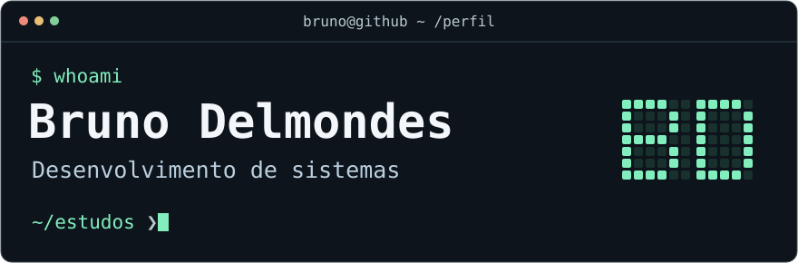
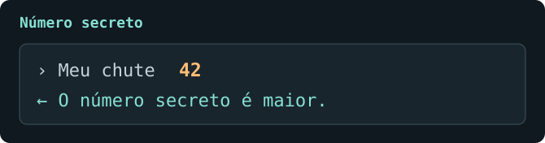

[LinkedIn](https://www.linkedin.com/in/brunodelmondesd/) · [Instagram](https://www.instagram.com/brunodelmondesd/)

## `~/sobre-mim`

Sou estagiário na PRODAM e curso Análise e Desenvolvimento de Sistemas na Cruzeiro do Sul. Meu interesse por sistemas começou durante a implantação de um ERP, quando eu trabalhava como analista de processos. Conferi dados de migração e ajudei a traduzir as necessidades das áreas fiscal, financeira e de faturamento em requisitos para a equipe de TI.

Hoje acompanho sistemas de folha de pagamento e estudo o caminho entre o cadastro e o contracheque. Pratico consultas em uma base Oracle de estudos, leio rotinas em PL/SQL e desenvolvo exercícios em C e JavaScript.

## `~/projetos`
### CoffeeGo

Desenhei o fluxo de pedido de uma cafeteria e testei se a pessoa conseguia concluir a compra e perceber que o pedido tinha sido recebido. A partir dos testes, trabalhei nos rótulos e no retorno visual das ações.

### Jogo do número secreto

Em JavaScript, usei `if/else` para comparar cada chute com o número sorteado e dar uma dica de maior ou menor. Com `while`, a partida continua até o acerto.

## `~/certificados`

Cursos de programação concluídos na Alura, acompanhando o início dos meus estudos.

| Curso | Carga horária | Conclusão | Certificado |
| --- | --- | --- | --- |
| Começando em Programação: carreira e primeiros passos | 1 hora | 16/10/2026 | [Ver na Alura](https://cursos.alura.com.br/certificate/46164438-1359-46e3-99c7-6a9c8611cc99) |
| Lógica de programação: mergulhe em programação com JavaScript | 6 horas | 17/11/2026 | [Ver na Alura](https://cursos.alura.com.br/certificate/3f0fa6f8-0771-4982-8477-61c95161f529) |

[Ver todos os certificados](./certificados/README.md) · Treinamentos da PRODAM em segurança da informação, LGPD e integridade disponíveis na pasta de certificados.
