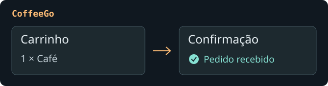
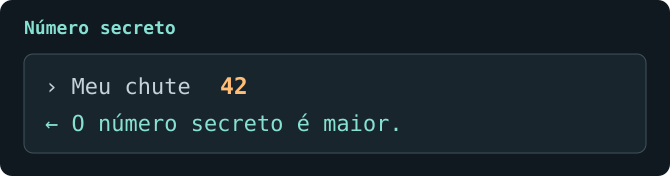

## Projetos em destaque

### CoffeeGo

Desenhei o fluxo de pedido de uma cafeteria e testei se a pessoa conseguia concluir a compra e perceber que o pedido tinha sido recebido. A partir dos testes, trabalhei nos rótulos e no retorno visual das ações.

### Jogo do número secreto

Em JavaScript, usei `if/else` para comparar cada chute com o número sorteado e dar uma dica de maior ou menor. Com `while`, a partida continua até o acerto.

## De processos a sistemas

Antes do estágio na PRODAM, trabalhei nas áreas fiscal, financeira e de faturamento. Como analista de processos, participei da implantação de um ERP, conferi dados de migração e ajudei a transformar as necessidades dos usuários em requisitos para a equipe de TI.

Hoje acompanho sistemas de folha de pagamento e estudo como os dados de cadastro e as regras de cálculo se refletem no contracheque. Na prática, trabalho minha leitura de PL/SQL, faço consultas em uma base Oracle de estudos e pratico C no Visual Studio e JavaScript com Git.

[LinkedIn](https://www.linkedin.com/in/brunodelmondesd/) · [Instagram](https://www.instagram.com/brunodelmondesd/)
