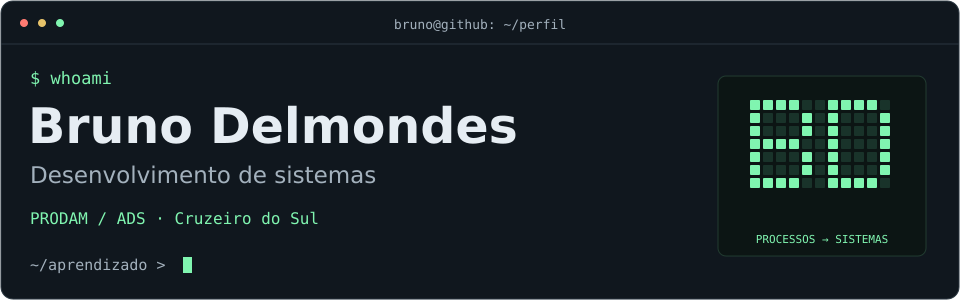
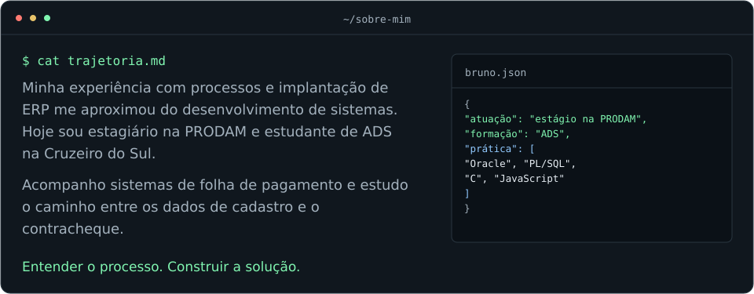
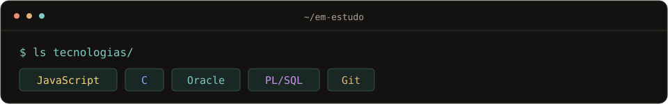
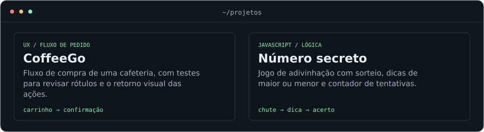
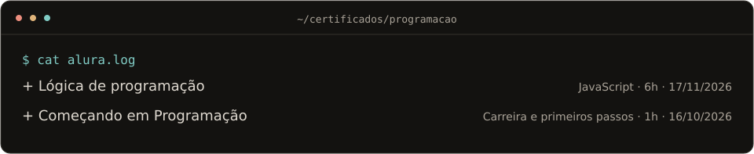

<picture>
  <source media="(max-width: 600px)" srcset="./assets/capa-mobile.svg">
  
</picture>

[LinkedIn](https://www.linkedin.com/in/brunodelmondesd/) · [Instagram](https://www.instagram.com/brunodelmondesd/) · [Certificados](./certificados/README.md)

<picture>
  <source media="(max-width: 600px)" srcset="./assets/sobre-mobile.svg">
  
</picture>

<picture>
  <source media="(max-width: 600px)" srcset="./assets/estudos-mobile.svg">
  
</picture>

<picture>
  <source media="(max-width: 600px)" srcset="./assets/projetos-mobile.svg">
  
</picture>

[Código do jogo do número secreto — repositório privado](https://github.com/delmondesbruno/logica-js-projeto_inicial)

<picture>
  <source media="(max-width: 600px)" srcset="./assets/certificados-mobile.svg">
  
</picture>

[Certificado de JavaScript](https://cursos.alura.com.br/certificate/3f0fa6f8-0771-4982-8477-61c95161f529) · [Certificado de primeiros passos](https://cursos.alura.com.br/certificate/46164438-1359-46e3-99c7-6a9c8611cc99)

[Todos os certificados e treinamentos da PRODAM](./certificados/README.md)

Sobre mim — versão em texto

Sou Bruno Delmondes, estagiário na PRODAM e estudante de Análise e Desenvolvimento de Sistemas na Cruzeiro do Sul.

Antes do estágio, trabalhei nas áreas fiscal, financeira e de faturamento. Como analista de processos, participei da implantação de um ERP, conferi dados de migração e ajudei a traduzir necessidades dos usuários em requisitos para a equipe de TI.

Hoje acompanho sistemas de folha de pagamento e estudo a relação entre dados de cadastro, regras de cálculo e contracheque. Pratico consultas em uma base Oracle de estudos, leio PL/SQL e desenvolvo exercícios em C e JavaScript.

No CoffeeGo, desenhei o fluxo de pedido de uma cafeteria e usei testes para trabalhar rótulos e retorno visual. No jogo do número secreto, pratico sorteio, condições, repetição e contagem de tentativas.

