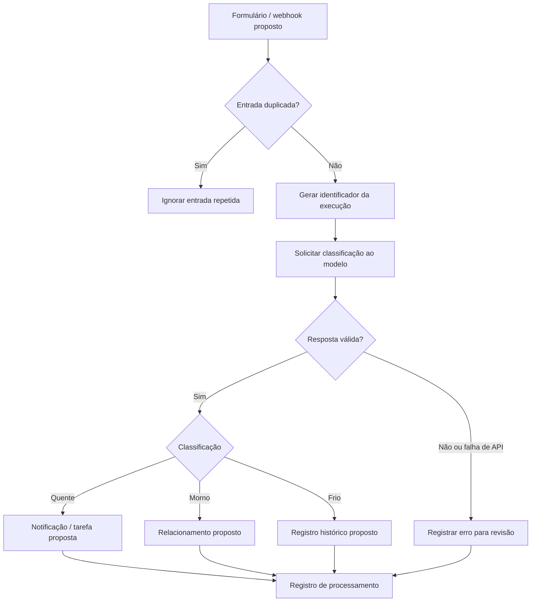

# 03 — Proposta de automação para classificação de contatos

[Voltar aos estudos](./README.md)

## Objetivo e situação

Desenhar um fluxo para receber uma mensagem de formulário, classificar o interesse comercial e encaminhar o contato. O material apresenta uma arquitetura conceitual com ferramentas low-code e um modelo de linguagem.

**Situação: proposta documentada.** O PDF não inclui a captura dos módulos configurados e não demonstra uma execução completa. Não há endpoint ou serviço publicado nesta pasta.

## Fluxo reorganizado a partir da descrição



Este diagrama foi reconstruído a partir do texto, pois a imagem de fluxo no PDF está cortada. A trilha de erro fica separada de uma classificação comercial válida: uma falha técnica não demonstra interesse intermediário do contato.

## Critérios do exercício

| Classe | Critério descrito |
| --- | --- |
| Quente | Mensagem com urgência, orçamento ou necessidade clara. |
| Morno | Interesse inicial ou dúvidas gerais. |
| Frio | Oferta de serviço, spam ou mensagem sem relação com a demanda. |

O texto original usa CoffeeGO como nome de uma agência fictícia. Este cenário não é uma funcionalidade do aplicativo de cafeteria CoffeeGo.

## Contrato de saída a revisar

```json
{
  "classificacao": "Quente",
  "justificativa": "Urgência e orçamento mencionados na mensagem."
}
```

O objeto é apenas um exemplo de formato. O documento alterna entre duas chaves e a inclusão de um campo de confiança. Antes de implementar, é necessário fixar o contrato, validar os campos em código e definir como lidar com mensagens ambíguas. Uma pontuação produzida pelo modelo não é uma probabilidade calibrada sem avaliação.

## Limites e decisões pendentes

- A busca prévia por e-mail ou identificador é uma proposta de deduplicação; não foi testada sob entradas simultâneas.
- A estimativa original de R$ 0,05 por contato é uma hipótese sem memória de cálculo anexada. Não é uma cotação atual nem custo medido.
- A seção de configuração menciona GPT-4o e outras ferramentas como contexto acadêmico; não comprova integração em funcionamento.
- A instrução para ignorar comandos contidos na mensagem precisa de controles e testes adicionais. Não representa proteção garantida contra manipulação. [Referência: OWASP](https://genai.owasp.org/llmrisk/llm01-prompt-injection/).

## Evidência necessária para evoluir o projeto

Configuração exportada sem credenciais; exemplos fictícios de entrada e saída; registro de execução; teste de entrada duplicada; simulação de falha de API; teste de resposta fora do formato; e cálculo de custo com premissas e data.

**Fonte:** Engenharia de Prompt - IA - Atv 3.pdf, páginas 4–7. O fluxo completo acima é uma reorganização editorial, não uma captura de uma automação executada.
