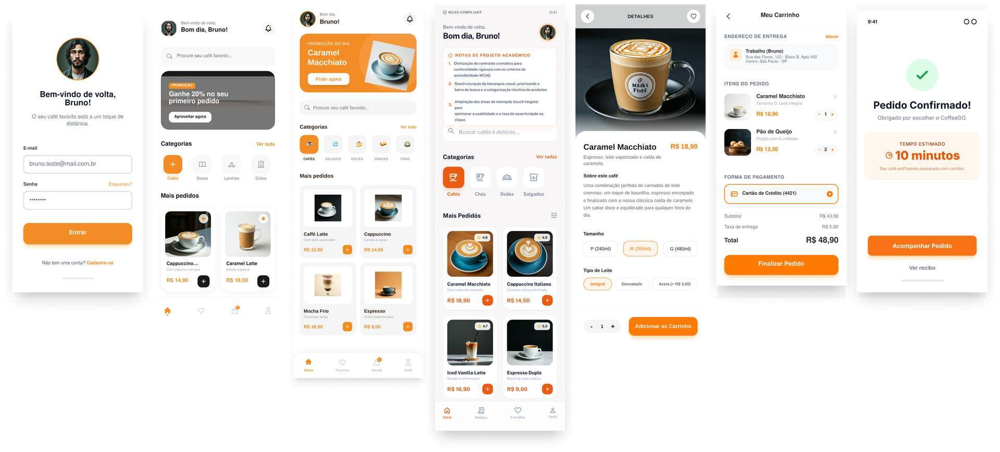

# CoffeeGo

**Estudo acadêmico de experiência do usuário para pedidos e retirada de café.**

O CoffeeGo explora como tornar um pedido rápido e previsível: escolher uma bebida, personalizar, conferir o carrinho e entender que o pedido foi confirmado.

## O problema

Uma pessoa com pouco tempo quer concluir o pedido rapidamente. Outra precisa de mais informações antes de pagar. A proposta busca atender os dois perfis, combinando um fluxo direto com detalhes disponíveis durante a escolha.

## Meu trabalho no estudo

- Organização de necessidades e de dois perfis de usuário.
- Definição do conceito, funcionalidades e sequência de navegação.
- Apresentação de wireframes e evolução visual das telas.
- Planejamento e registro de observações de testes de usabilidade.
- Priorização de dúvidas sobre pagamento e de necessidades de informação.

## Uma decisão de interface

O relatório registra que os participantes ficaram em dúvida após finalizar o pagamento. A mudança descrita foi reforçar a confirmação do pedido, com mensagem de sucesso e acesso ao acompanhamento. A tela final apresentada no trabalho inclui essas respostas visuais.

O efeito dessa mudança ainda precisa ser confirmado em um novo teste: não há comparação documentada de resultados antes e depois.

## Explore o processo

- [Personas, fluxo e decisões de interface](./processo.md)
- [Galeria: dos wireframes às telas finais](./galeria.md)
- [Testes, evidências e limites do estudo](./evidencias.md)
- [Documentos de origem](./fontes.md)

## Situação atual

Este portfólio reúne documentação acadêmica e imagens extraídas dos trabalhos. Não há código de aplicativo, integração de pagamento ou protótipo interativo disponível nesta pasta. As imagens demonstram a proposta visual; não comprovam funcionalidades implementadas.

Os próximos passos são recuperar o arquivo editável do protótipo, esclarecer a metodologia dos testes e avaliar novamente a versão refinada.

**Autor:** Bruno Delmondes · Análise e Desenvolvimento de Sistemas, Cruzeiro do Sul.

[Voltar ao perfil](../../README.md) · [Estudos de engenharia de prompt](../../estudos/engenharia-de-prompt/README.md)
