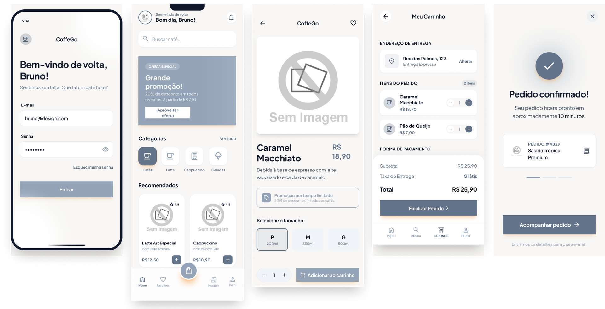
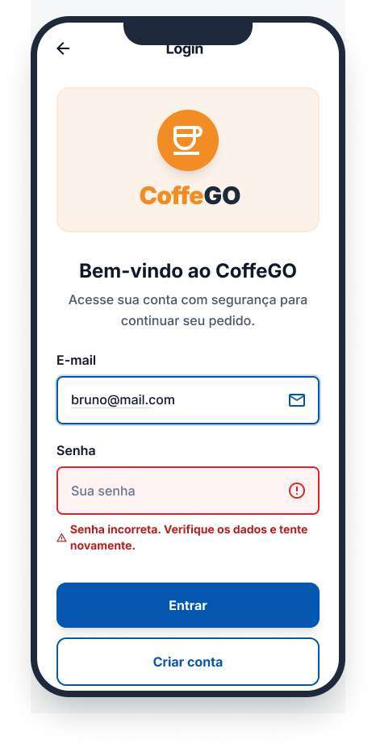
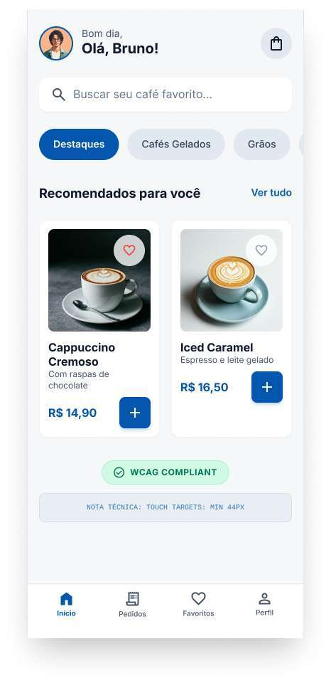
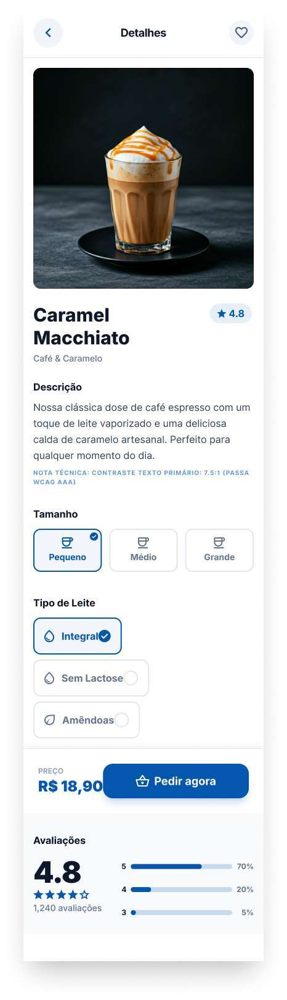
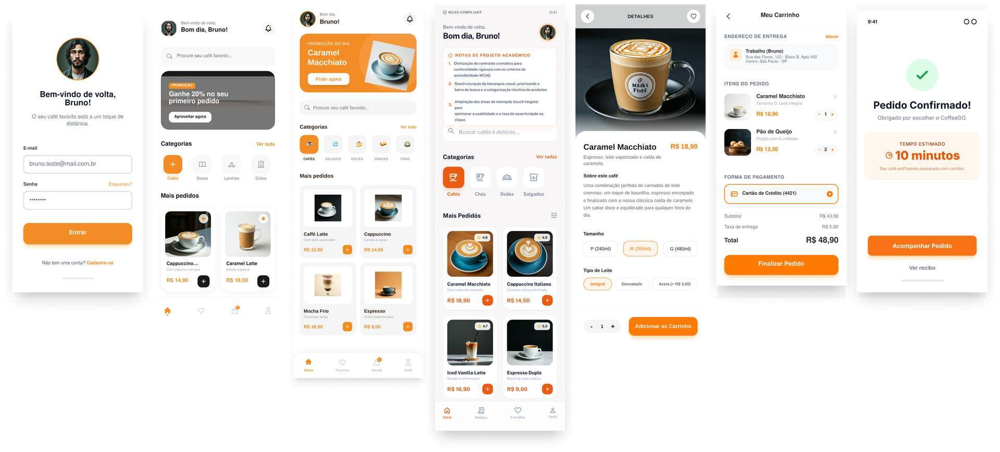

# CoffeeGo — evolução das telas

[Voltar ao projeto](./README.md)

As imagens abaixo foram extraídas dos PDFs acadêmicos, sem redesenho. Elas documentam a apresentação visual existente no material e não equivalem a uma demonstração interativa. Abra cada imagem para ver os detalhes.

## 1. Wireframes

Origem: atividade de wireframe, página 8.

## 2. Protótipo apresentado na etapa de média fidelidade

  
  
  

Origem: atividade de linguagem visual e acessibilidade, página 3.

**Nota de leitura:** selos de conformidade e valores de contraste aparecem nas próprias ilustrações do trabalho. Não foram auditados nesta organização do portfólio. Conformidade WCAG exige avaliar os critérios aplicáveis e o funcionamento do conteúdo; a imagem, por si só, não comprova esse resultado. [Referência: W3C](https://www.w3.org/WAI/WCAG22/Understanding/conformance).

## 3. Telas apresentadas como versão final

Origem: relatório de testes de usabilidade, página 7. A confirmação e o acompanhamento estão visíveis na composição. O comportamento real desses elementos não foi verificado.
