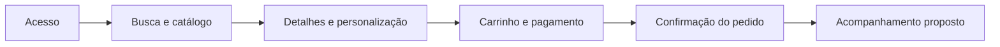

# CoffeeGo — processo e decisões

[Apresentação](./README.md) · [Galeria](./galeria.md) · [Evidências](./evidencias.md)

## Necessidades consideradas

O material identifica rapidez, clareza de preços, personalização e confirmação das ações como necessidades recorrentes. As personas são representações acadêmicas; a documentação disponível não permite afirmar que foram validadas por pesquisa representativa.

| Persona do estudo | Contexto | Necessidade que orienta o fluxo |
| --- | --- | --- |
| Rafael Mendes, 29 anos | Rotina profissional com pouco tempo disponível | Escolher e concluir o pedido com poucos obstáculos. |
| Mariana Souza, 22 anos | Estudante e estagiária que analisa as opções antes de comprar | Conferir informações e ter segurança sobre a confirmação do pedido. |

Os nomes e perfis acima são fictícios, conforme a atividade de wireframes.

## Fluxo proposto

O diagrama reorganiza em texto as etapas descritas nos trabalhos. Não representa um sistema executável.

## Decisões registradas

| Observação ou necessidade | Decisão descrita | Como verificar a decisão |
| --- | --- | --- |
| Incerteza ao concluir o pagamento | Mensagem de pedido confirmado e acesso ao acompanhamento | Observar se a pessoa reconhece a conclusão sem pedir ajuda. |
| Necessidade de mais informações do produto | Disponibilizar detalhes e opções de personalização | Verificar se a informação necessária é encontrada durante a escolha. |
| Desejo de rapidez | Busca, catálogo e sequência direta até o carrinho | Observar dificuldades e tempo de tarefa em condições definidas. |
| Diferentes condições de uso | Revisar contraste, rótulos, feedback e áreas de toque | Medir no arquivo editável e testar na implementação. |

## Evolução visual

O conjunto passa de wireframes neutros para telas com componentes e cores. A etapa intermediária usa azul como destaque; a versão final apresentada usa laranja. Essa diferença é registrada como evolução visual, sem supor que existam arquivos editáveis que comprovem cada mudança.

## O que aprendi com o caso

Diminuir etapas não basta: a interface precisa comunicar o que aconteceu, principalmente quando o fluxo envolve pagamento. As justificativas de design ficam mais claras quando ligadas a uma dúvida observada e a um critério para verificar a melhoria.
